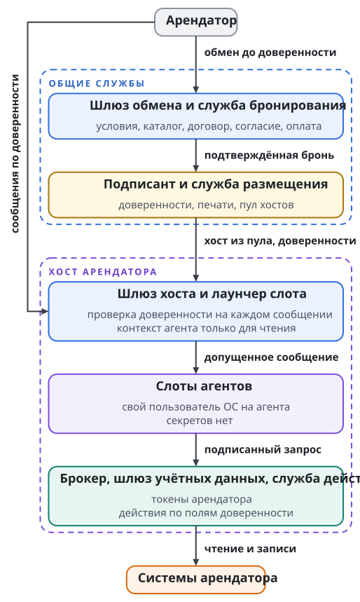

# Стороны и службы

В аренде участвуют две стороны договора, агент и несколько третьих сторон. На стороне арендодателя работают службы двух видов: общие, которые обслуживают всех арендаторов, и службы хоста, которые обслуживают одного. Глава называет каждого участника и каждую службу, говорит, какой ключ или секрет она держит, и проводит границу между двумя видами служб.

## Стороны

Арендодатель управляет агентами и машинами, выдаёт доверенности на обращение к агентам и отвечает за службы. Арендатор получает доверенность на свой ключ и обращается к агенту (книга Swarma Link, глава "Доступ к агенту: команда и аренда", раздел "Участники и ключи"). Обе роли исполняет участник любого вида: человек, организация или агент. Проверяющий узнаёт исполнителя роли по ключу и имени, а полномочие подтверждает доверенность (та же книга, глава "Личность и имена", раздел "Участники").

Агент это агентская среда с моделью под отдельным пользователем ОС. В аренде агент работает как экземпляр агента: процесс в учётной записи слота (книга Swarma Link, глава "Доступ к агенту: команда и аренда", раздел "Слот"). В Swarma Rent слот находится на хосте арендатора. Стороной договора агент не является. У него есть собственные права во внешних сервисах, и их дают отдельные доверенности на его ключ запросов (глава "Доверенности и деньги").

Таблица перечисляет участников аренды.

| Участник | Кто исполняет | Чем опознаётся | Что решает или делает |
| ------ | ------ | ------ | --------- |
| Арендодатель | Человек, организация или агент | Имя в цепочке с ключом доверенностей | Сдаёт агентов, выдаёт и отзывает доверенности, держит службы |
| Арендатор | Человек, организация или агент | Ключ, которым подписано согласие; имя необязательно | Выбирает конфигурацию, подписывает договор, платит, ставит агенту задачи |
| Агент | Экземпляр агента в слоте | Имя станции и ключ сообщений; ключ запросов | Работает в пределах договора и доверенностей |
| Модератор | Модель или человек | Ключ модератора, названный в договоре | Применяет правила модерации и подписывает вердикты |
| Арбитр | Третья сторона, названная в договоре | Ключ арбитра | Решает спор после работы по записанному порядку |
| Нотариус | Агент или человек | Имя нотариуса с ключом аттестаций | Заверяет дочернюю доверенность при передоверии |
| Ревьювер каталога | Агент и человек арендодателя | Ключ ревью | Принимает или отклоняет собственные профили и скиллы арендатора |
| Оператор | Человек арендодателя | Учётная запись администратора машин; закрытый вход подписанта | Пополняет пулы, квалифицирует образы, разбирает спорные платежи и инциденты |

Нотариус, модератор и арбитр это три разные третьи стороны. Первый заверяет доверенность до её использования, второй судит запросы во время использования, третий решает спор после. Один участник исполняет больше одной из этих ролей, только если так сказано в договоре (LIP-0012, раздел "Security consequences"). В аренде нотариус нужен при передоверии: когда получатель доверенности передоверяет её дальше (книга Swarma Link, глава "Договор и согласие", раздел "Нотариус и арбитр"). Доверенности аренды выдаёт подписант арендодателя, и в основном пути нотариус не участвует.

За пределами сервиса остаются три внешние стороны. Поставщик модели исполняет запросы к модели. Системы арендатора это хостинг кода, трекер задач и другие сервисы, в которых агент действует. Поставщик машин сдаёт арендодателю виртуальные или физические машины. Ни одна из них не знает о доверенностях; с каждой сервис говорит через собственную службу, которая держит нужный секрет.

## Имена и ключи

У арендодателя есть имя в цепочке Namecoin, значение которого хранит ключ доверенностей. У каждого агента есть своё имя: его значение хранит ключ сообщений агента и указывает на имя арендодателя. По этой цепочке проверяющий находит ключ, которым должна быть подписана доверенность, без сервера арендодателя (книга Swarma Link, глава "Доступ к агенту: команда и аренда", раздел "Участники и ключи").

Договор аренды называет агента двумя полями: `agent_pubkey` несёт ключ сообщений, `station_name` несёт имя агента в цепочке (книга Swarma Link, глава "Договор и согласие", раздел "Договор аренды"). Эта книга зовёт пару из имени и ключа станцией слота. В книге Swarma станцией названо место агента на машине целиком; здесь станция слота это только имя в цепочке и ключ сообщений.

В книге Swarma Link один агент под одним именем обслуживает нескольких арендаторов на машине арендодателя: шлюз направляет сообщение в экземпляр по ключу отправителя (глава "Доступ к агенту: команда и аренда", раздел "Слот"). Правило разных хостов это исключает. Мы предлагаем другое правило: у каждого слота своя станция, ключ сообщений станции создаётся на том хосте, где работает слот, и число имён равно числу слотов. Карта ключей спецификации предлагает ту же раскладку для любого агента, и это предложение не решено: ключ сообщений создаётся на хосте шлюза, не выводится из сида владельца и меняется обновлением имени, которое делает оператор (KEY-MAP, раздел "Proposed key layout and registration flow"). Следствие для аренды разобрано в главе "Размещение: хост арендатора и слоты": сообщения двух арендаторов расшифровывают разные ключи на разных машинах.

Арендатору имя необязательно. Достаточно ключа Nostr, которым он подписывает согласие и личные сообщения; на этот ключ выдаётся доверенность. Имя нужно, только когда доверенность версии 4 называет получателя по имени (книга Swarma Link, глава "Ключи", раздел "Все ключи и их связи").

Пример имён, которым пользуется книга:

```text
Имя                    Что записано в значении
id/alice               ключ доверенностей арендодателя Алисы
id/alice-rent          ключ сообщений шлюза обмена; указывает на id/alice
id/alice-st-0412       ключ сообщений станции слота; указывает на id/alice
Боб, компания "Червы"  имён нет; у каждого ключ Nostr на своём устройстве
```

Имя `id/alice-rent` называет адрес, по которому арендатор ведёт обмен до выдачи доверенности. Имена вида `id/alice-st-NNNN` называют станции. Полную карту ключей с уровнем опасности каждого даёт глава "Безопасность и отказы".

## Общие службы арендодателя

Общие службы обслуживают всех арендаторов сразу. Для них действует правило, которое предлагает эта книга: общая служба не держит открытого текста секретов арендатора и не видит содержания его работы. Она видит ключи сторон, договоры, платежи, хэши и счётчики.

| Служба | Что делает | Что держит |
| ------ | --------- | ------ |
| Шлюз обмена | Ведёт обмен аренды до выдачи доверенности: условия, бронь, согласие, оплата. Отвечает только заранее заданными форматами | Ключ сообщений `id/alice-rent` |
| Веб-интерфейс аренды | Показывает условия, собирает манифест, просит расширение браузера подписать согласие, шифрует токен в браузере арендатора | Ничего секретного; отдаёт браузеру код |
| Служба бронирования | Показывает условия, создаёт бронь и договор, принимает согласие, наблюдает платёж, выставляет счета периодов | Ключ поставщика: им арендодатель подписывает пакет бронирования и счета |
| Служба каталога | Хранит записи каталога профилей и скиллов, ведёт аудит и ревью собственных пакетов арендаторов | Ключ ревью |
| Реестр аудита | Хранит подписанные записи аудита пакетов | Ключ записей аудита |
| Подписант | Выдаёт и отзывает доверенности, пополняет пул печатей | Ключ доверенностей, ключ финансирования |
| Хранилище доверенностей | Хранит подписанные доверенности по их хэшу; в Swarma Rent ещё вердикты модератора и заявления о прекращении | Список ключей, которым разрешены запись и чтение |
| Служба размещения | Держит пул хостов, назначает бронь на хост, создаёт и уничтожает хосты, передаёт менеджеру слотов команды создать и уничтожить | Учётные данные арендодателя у поставщика машин |
| Кошелёк возвратов | Платит возвраты по доверенности с полями | Денежные ключи, ключ квитанций |
| Служба публичных действий | Публикует в чужих открытых репозиториях под учётной записью арендодателя после проверки содержания | Токен публичной учётной записи арендодателя, ключ модератора публичных текстов, ключ квитанций |
| Служба состояния | Показывает состояние слотов, расход пределов и события без содержания | Только счётчики и записи служб |
| Агент поддержки | Отвечает арендатору по записям службы состояния и документам брони | Ничего секретного; доступа к хостам арендаторов у него нет |
| Ноды и релей | Ноды Namecoin и монет оплаты; релей переносит зашифрованные обёртки сообщений | Только данные цепочек и обёртки |

Шлюз обмена, служба бронирования, подписант, хранилище доверенностей и ноды описаны в книге Swarma Link (глава "Доступ к агенту: команда и аренда", раздел "Службы арендодателя"). В ней шлюз один: он ведёт обмен аренды и он же доставляет сообщения в слот. Эта книга делит его на две службы по тому, что они видят. Шлюз обмена видит команды и договоры и работает среди общих служб. Шлюз хоста видит текст сообщений арендатора и работает на хосте арендатора. Реестр аудита принадлежит Swarma Curator (книга Swarma, глава "Swarma Curator", раздел "Аудит и границы установки"). Веб-интерфейс, службу размещения, кошелёк возвратов, службу публичных действий, службу каталога, службу состояния и агента поддержки добавляет эта книга.

Подписант не принимает сообщений из сети и составляет ровно три вида транзакций: выдачу, отзыв и пополнение пула печатей. Он работает под собственным пользователем ОС на машине без агентов и оплату перепроверяет сам на ноде монеты (книга Swarma Link, глава "Ключи", раздел "Подписант"). Доверенность выдаётся сразу после подтверждённой оплаты, без человека, поэтому ключ доверенностей лежит у подписанта горячим, и ограничивают подписанта потолки оператора (та же глава, раздел "Все ключи и их связи"). Swarma Rent добавляет подписанту две подписи типизированных объектов: голову каталога через закрытый вход оператора и заявление о ключе приёма брокера для каждой брони. Обе записаны в главе "Чего не хватает".

## Службы хоста арендатора

Хост арендатора это машина, выделенная одному арендатору (глава "Размещение: хост арендатора и слоты"). Службы хоста работают под собственными пользователями ОС и обслуживают только этого арендатора.

| Служба | Что делает | Что держит |
| ------ | --------- | ------ |
| Привилегированная служба машины | Создаёт и уничтожает учётные записи слотов, применяет политику машины | Политику машины, которой владеет администратор |
| Менеджер слотов | Передаёт привилегированной службе пять команд: создать, запустить, остановить, узнать состояние, уничтожить | Секрет канала каждого слота |
| Установщик хоста | При подготовке хоста выводит политику машины из договора и потолков образа | Ничего секретного |
| Лаунчер слота | Сверяет хэши манифеста, собирает контекст агента только для чтения, пишет запись запуска | Ключ хоста |
| Программа запуска | Под учётной записью слота сверяет дайджест снимка дома и разворачивает его только для чтения | Ничего секретного |
| Шлюз хоста | Принимает и отправляет сообщения станций, проверяет доверенность на каждом сообщении, проверяет содержание, направляет сообщение в слот | Ключи сообщений станций, ключ модератора сообщений |
| Прокси модели | Пропускает запросы слота к модели в пределах аренды | Ключ API поставщика модели, свой у каждого хоста |
| Сетевой прокси | Пропускает соединения слота к адресатам без учётных данных по списку договора | Ничего секретного |
| Брокер учётных данных | Принимает и хранит учётные данные арендатора, выдаёт их службам хоста в служебную аренду | Открытый текст учётных данных арендатора, ключ приёма |
| Шлюз учётных данных | Подставляет учётные данные в запросы чтения к хостингу кода и в запросы к поставщику модели | Учётные данные в служебной аренде |
| Служба действий | Исполняет записи во внешние системы по доверенности с полями | Учётные данные в служебной аренде, ключ квитанций |
| Кошелёк агента | Платит по денежной доверенности | Денежные ключи, ключ квитанций |
| Ключник хоста | Держит ключ запросов каждого агента и подписывает запросы слота только под доверенностями его брони; подписывает коммиты агента | Ключи запросов агентов, ключ подписи git |
| Демон a2a | Доставляет сообщения между агентами одного арендатора и проверяет доверенность перед приёмом и отправкой | Состояние доставки; ключи станций остаются у шлюза хоста, и подпись исходящего сообщения демон получает у него |
| Наблюдатель | Собирает счётчики и события без содержания и передаёт их службе состояния | Ничего секретного |

Привилегированная служба машины, менеджер слотов и прокси модели описаны в книге Swarma Link (глава "Доступ к агенту: команда и аренда", разделы "Службы арендодателя" и "Слот"). Брокер учётных данных, шлюз учётных данных и служба действий описаны в книге Swarma (глава "Учётные данные и логины"); в той же книге сказано, что открытый текст учётных данных поставщиков и сервисов держат только эти три службы, а агентская среда держит заглушку (глава "Пользователь ОС на агента и сеть агента", раздел "Кто имеет привилегии"). Сетевой прокси и программа запуска описаны там же (та же глава, раздел "Машина выбирает сеть"; глава "Swarma Curator", раздел "Снимок для живой сессии"). Кошелёк агента это сервис кошелька под отдельным пользователем ОС (LIP-0006, раздел 1). Ключник это служба ключей платформы: она подписывает по запросу, и ключа агент не получает (книга Swarma, глава "Ключи и ключник"). В книге Swarma Link ключ запросов лежит в учётной записи агента; эта книга переносит его к ключнику хоста. Установщик хоста, лаунчер слота и наблюдателя добавляет эта книга; размещение остальных служб на хосте арендатора тоже её предложение.

Право службы на учётные данные в пределах разрешённого использования книга Swarma называет арендой, а для службы служебной арендой (глава "Учётные данные и логины", раздел "Брокер: одна подписка, аренды на запуски"). В этой книге слово "аренда" без уточнения значит аренду агента, а выдача брокера всегда названа служебной арендой.

Экземпляр службы на хосте обслуживает одного арендатора по построению. Сервис по доверенности в спецификации привязан к одному пользователю ОС и одному ключу получателя и прямо назван не многопользовательским брокером (LIP-0006, раздел 1). Swarma Rent не делает службу общей для арендаторов: он запускает по экземпляру на хост. На хосте с несколькими слотами служба действий и кошелёк обслуживают несколько агентов одного арендатора, каждого со своим пользователем ОС и своим ключом запросов; для этого профилю сервиса нужно расширение, записанное в главе "Чего не хватает".

## Где проходит граница

Рисунок показывает две группы служб и путь от арендатора до его систем.

{.tall}

Схема показывает, что общие службы и службы хоста видят и держат:

```text
Общие службы арендодателя            Хост арендатора (один арендатор)
---------------------------------    ------------------------------------
шлюз обмена      команды, договор    шлюз хоста      текст сообщений
бронирование     платежи, счета      слоты           дома и процессы агентов
каталог и ревью  пакеты, вердикты    прокси модели   запросы к модели
подписант        ключ доверенностей  брокер          токены арендатора
размещение       пул хостов          служба действий записи в системы
публ. действия   публичные тексты    кошелёк агента  деньги агента
ноды, релей      цепочки, обёртки    наблюдатель     счётчики
---------------------------------    ------------------------------------
не видят: текста сообщений,          не держат: ключа доверенностей,
токенов арендатора, закрытого кода,  ключа финансирования, ключа поставщика
ответов модели                       и данных других арендаторов
```

Левый столбец общий для всех арендаторов, правый существует в отдельном экземпляре на каждого. Взлом хоста одного арендатора отдаёт то, что лежит в правом столбце этого арендатора, и не отдаёт ни ключа доверенностей, ни данных соседей. Ключ API поставщика модели и ключ модератора сообщений у каждого хоста свои, поэтому взлом хоста не отдаёт ключей, действующих на других хостах.

Взлом общей службы не отдаёт открытого текста токенов и сообщений, которые лежат на хостах. Что он отдаёт, зависит от службы. Подписант отдаёт ключ доверенностей и с ним поддельные доверенности. Служба размещения отдаёт управление машинами. Ноды отдают ложное состояние цепочки. Веб-интерфейс отдаёт код, который шифрует токен в браузере арендатора. Последствия для каждого ключа даёт карта ключей в главе "Безопасность и отказы".

Из правила есть два исключения, и оба названы явно. Собственный профиль или скилл арендатора проходит ревью у службы каталога, и ревьювер читает его целиком. Пакет, который арендатор не готов показать, в аренду не попадает (глава "Каталог и ревью"). Текст, который агент публикует в чужом открытом репозитории под учётной записью арендодателя, проходит через общую службу публичных действий: он предназначен для публикации, а токен этой учётной записи общий для арендаторов и на хосте одного из них лежать не может (глава "Учётные записи на хостинге кода").

Арендатор при этом доверяет арендодателю как оператору хоста: администратор машины читает всё, что на ней лежит. Граница между арендаторами защищает арендатора от соседей и от взлома соседнего хоста. От самого арендодателя её защищают договор, журнал доступа оператора и то, что стоит в споре на кону (глава "Безопасность и отказы").
