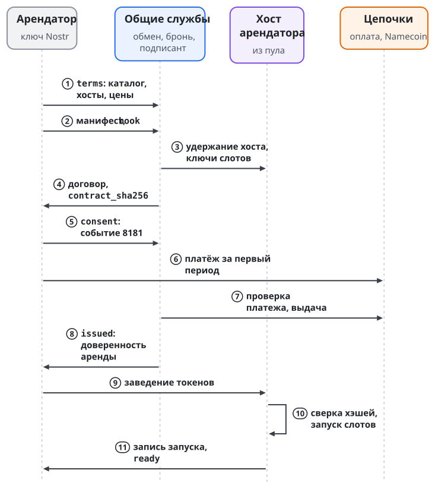

# Путь арендатора

Аренда проходит одиннадцать этапов: условия, конфигурация, бронь, согласие, оплата, выдача, подготовка хоста, работа, оплата периодов, конец и уход. Глава проходит их по порядку и на каждом говорит, что делает арендатор, какая служба отвечает и какой документ остаётся у сторон. Части, которым посвящены отдельные главы, здесь названы коротко.

| Этап | Что делает арендатор | Что делает сервис | Что появляется |
| ---- | ------ | ------ | ------ |
| Условия | Запрашивает условия | Шлюз обмена отвечает заранее заданным форматом | Каталог, классы хостов, цены, монеты оплаты, уведомление о приватности |
| Конфигурация | Собирает манифест конфигурации | Каталог проверяет записи; собственные пакеты идут на ревью | Манифест и его хэш |
| Бронь | Просит бронь | Служба бронирования составляет договор аренды и условия доступа, служба размещения удерживает хост | Договор аренды, его идентификатор, срок удержания |
| Согласие | Подписывает два события согласия | Проверяет подписи и теги | Заключённый договор аренды; согласие на доверенность аренды |
| Оплата | Платит первый период в BTC, LTC или BCH | Засчитывает платёж по глубине; подписант перепроверяет его сам | Запись о зачёте |
| Выдача | Получает доверенность аренды | Подписант закрепляет договор, выдаёт доверенности и закрепляет каждую | Доверенности, записи в цепочке |
| Подготовка | Заводит учётные данные у брокера | Менеджер слотов создаёт учётные записи, лаунчер слота сверяет хэши и готовит дома агентов | Готовность |
| Работа | Пишет агенту, читает квитанции | Шлюз хоста и сервисы по доверенности проверяют каждое действие | Сообщения, квитанции, результаты в системах арендатора |
| Периоды | Платит следующий период | Выставляет счёт периода; при неоплате приостанавливает | Запись о зачёте |
| Конец | Ждёт конца срока или просит о прекращении | Конец окна или трата печати договора; брокер уничтожает учётные данные | Закрытие доверенностей |
| Уход | Забирает выгрузку, отзывает токены у себя | Уничтожает учётные записи слотов и хост; возвращает положенное | Запись об удалении, квитанция возврата |

Рисунок показывает путь до готовности по шагам; общие службы стоят в нём одним столбцом.

{.tall}

## Условия

Арендатор начинает с имени арендодателя. Он читает значения имён `id/alice` и `id/alice-rent` на своей ноде Namecoin или доверяет веб-странице аренды, которая показывает те же имена. Веб-страница служит одним из клиентов обмена: сам обмен идёт личными сообщениями Nostr по NIP-17 (книга Swarma Link, глава "Доступ к агенту: команда и аренда", раздел "Сообщения").

Отправитель без действующей доверенности не достигает ни модели, ни агента. Шлюз стенда отвечает ему только на три точные команды и только заранее заданными форматами; ключом агента он не подписывает ни произвольных текстов ошибок, ни вывода модели. Первое сообщение незнакомого ключа несёт доказательство работы по NIP-13, по умолчанию 16 бит, и шлюз ограничивает каждый ключ запасом команд (та же глава, разделы "Обмен до доверенности" и "Первое обращение"). Swarma Rent сохраняет этот порядок: на команды отвечает шлюз обмена своим ключом `id/alice-rent`, а содержание ответов меняется под версию 4. Точные форматы обмена версии 4 записаны в главе "Чего не хватает".

Команда `terms` стенда возвращает имена, шаблоны договора, слоты, цены и уведомление о приватности с его хэшем (та же глава, раздел "Обмен до доверенности"). В Swarma Rent ответ дополнен четырьмя частями: заявлением о текущем каталоге профилей и скиллов, списком классов хостов с числом слотов в каждом, списком адаптеров систем, которые арендодатель поддерживает, и условиями оплаты для каждой из трёх монет с минимумом глубины и сроком удержания брони. Уведомление о приватности говорит, что видит оператор хоста, сколько хранятся журналы служб, как удаляются данные и что запросы по доверенности подписаны и могут быть раскрыты модератору и арбитру (LIP-0011, раздел 7).

## Конфигурация

Арендатор собирает конфигурацию в веб-интерфейсе. Он выбирает число агентов, профиль и скиллы каждого, системы, в которых агенты действуют, а также условия договора: размещение агентов по машинам, вид хоста, агентскую среду, пределы, срок и монету оплаты. Интерфейс не принимает свободного текста настроек: каждая настройка есть выбор записи каталога или значение поля договора.

Профиль и скилл арендатор берёт из каталога арендодателя или приносит свои. Собственный пакет сначала проходит аудит и ревью; до принятия выбрать его нельзя (глава "Каталог и ревью"). Система выбирается как пара из адаптера и области: адаптер хостинга кода и список репозиториев, адаптер трекера и проект. Секретов на этом этапе арендатор не вводит: манифест называет системы, и токенов в нём нет.

Итог этапа это манифест конфигурации и его хэш. Служба каталога проверяет манифест целиком: каждая запись существует, её хэш совпадает с записью каталога, ревью действует, выбранные системы совместимы с профилями, и адресаты, которые объявил каждый пакет, входят в адресаты выбранных систем. Служба бронирования проверяет остальные условия: класс хоста вмещает выбранное число слотов, а пределы не превышают потолков оператора. Манифест с ошибкой не получает брони. Поля манифеста и порядок их проверки даёт глава "Манифест конфигурации".

## Бронь и договор

Бронь удерживает хост на время согласия и оплаты. Служба размещения берёт из пула хост выбранного класса и закрепляет его за бронью. Хост из пула уже несёт ключи сообщений станций и ключи своих сервисов по доверенности: их открытые части записаны в имена при пополнении пула. При брони хост создаёт для каждого слота ключ запросов агента и сообщает службе бронирования только открытую часть. Закрытые части всех ключей остаются на хосте. Срок удержания задаёт профиль оплаты выбранной монеты, и он всегда короче 72 часов (глава "Оплата и возврат", раздел "Зачёт и глубина подтверждений"). Бронь, которая истекла без выдачи, возвращает хост в пул после стирания ключей запросов.

В ответ на просьбу о брони арендатор получает два документа в точных байтах: договор аренды и условия доступа. Договор аренды это рамочный договор брони: стороны, срок в высотах блоков, текст условий, поля для машины, хэш манифеста конфигурации и печать договора. Условия доступа это наименьший договор, на который сошлётся доверенность аренды: получатель, станции слотов с их ключами и доли. Оба устроены как договор версии 4, с солями и идентификатором (глава "Доверенности и деньги", раздел "Договор аренды и условия доверенностей").

Таблица даёт логический состав договора аренды; профиля договора аренды с точными байтами спецификация не содержит.

| Группа условий | Что называет | Где разобрано |
| ------ | --------- | ------ |
| Конфигурация | Хэш манифеста конфигурации | "Манифест конфигурации" |
| Слоты | Для каждого слота: метку, агентскую среду, модель и наибольшие пределы | "Манифест конфигурации", "Доверенности и деньги" |
| Размещение | Класс хоста и раскладку слотов по хостам | "Размещение: хост арендатора и слоты" |
| Оплата | Монету, цену периода, расписание с адресами, правило курса, потолок счёта, минимум глубины, льготный срок | "Оплата и возврат" |
| Возврат | Адрес возврата, правило для каждого события, порог и срок возврата | Там же |
| Модерация | Хэш правил модерации, ключи модераторов и то, кто за ними стоит | "Доверенности и деньги" |
| Участники | Наибольшее число участников арендатора; какие агенты кому ставят задачи | Там же |
| Прекращение | Печать договора и условие расторжения; сроки, в которые арендодатель исполняет запросы арендатора | Там же |
| Данные | Срок окна выгрузки, срок хранения журналов служб, порядок удаления | "Учётные данные арендатора" |
| Приватность | Текст уведомления о приватности | Эта глава, раздел "Условия" |

Ключей станций и ключей запросов агентов в договоре аренды нет: их называют условия доверенностей. Поэтому замена хоста не трогает договор аренды (глава "Размещение: хост арендатора и слоты", раздел "Отказы размещения").

Любое изменение условий меняет идентификатор договора и требует новых подписей. Это относится и к манифесту: другой профиль, другой скилл или другая система дают другой хэш манифеста и другой договор аренды.

## Согласие

Арендатор подписывает два события согласия. Каждое это событие Nostr вида 8181 с пустым содержимым и тегами в точном порядке: метка `swarma-contract-consent/1`, генезис цепочки, идентификатор договора и ключ доверенностей арендодателя; для арендатора, названного именем, пятым тегом идёт имя (LIP-0020, раздел 7.2). Первое событие несёт идентификатор договора аренды и заключает его со стороны арендатора. Второе несёт идентификатор условий доступа, и его израсходует выдача доверенности аренды. С другой стороны оба документа подписывает арендодатель: ключ доверенностей подписывает согласие выдавшего, объект типа `swarma-contract-assent/1` (LIP-0020, раздел 7.1).

Подпись покрывает идентификатор договора, договор содержит хэш манифеста, манифест содержит хэши профилей и скиллов. Так одна подпись арендатора под договором аренды закрепляет всё, что названо в манифесте.

Согласие связано с договором, выдавшим и получателем и используется для одной выдачи; между его моментом `created_at` и первой транзакцией выдачи проходит не больше 72 часов (LIP-0020, раздел 7). Для арендатора из этого следуют две вещи. Повторная выдача после сбоя, новая доверенность аренды после замены хоста и продление требуют новой подписи каждая. И подписывать согласие заранее, задолго до оплаты, нельзя: событие устареет.

Согласия за ключи запросов агентов подписывает ключник хоста, за ключ запросов службы бронирования её ключник; арендатор видит условия эффектов каждого слота и условия возврата до своей подписи и сверяет их пределы с договором аренды.

Арендатор-агент проходит тот же обмен и подписывает события своим ключом: событие подписывает любой держатель ключа (книга Swarma Link, глава "Доступ к агенту: команда и аренда", раздел "Сообщения"). Договор за человека или организацию агент заключает только по доверенности, которая это разрешает: она называет участника, от имени которого действует агент, допустимых контрагентов, шаблон или точный документ, предельную сумму и окно (та же книга, глава "Договор и согласие", раздел "Договор и полномочия"). Служба бронирования проверяет такую доверенность и хранит её в пакете договора.

## Оплата

Сумму первого периода и адрес называет договор аренды. Арендатор платит в выбранной монете. Служба бронирования засчитывает платёж, когда выходы на адрес счёта набрали требуемую глубину в активной цепочке монеты; платёж в мемпуле не засчитывается. Подписант перед выдачей проверяет платёж сам, на собственной ноде монеты (глава "Оплата и возврат", раздел "Зачёт и глубина подтверждений").

Первый платёж покрывает первый период. Срок аренды длиннее периода, и следующие периоды оплачиваются по счетам. Сумма, которой арендатор рискует до начала работы, равна цене одного периода.

## Выдача

После зачтённого платежа подписант делает четыре вещи. Он закрепляет договор аренды записью в цепочке. Он строит транзакцию печати с печатями всех доверенностей брони. Он подписывает доверенности: доверенность аренды для арендатора, доверенность на эффекты для ключа запросов каждого агента, доверенности между агентами, если их называет договор, и доверенность на возврат для службы бронирования. И для каждой доверенности он отправляет транзакцию выдачи с записью, которая связывает договор, обе подписи согласия и доверенность (глава "Доверенности и деньги", раздел "Выдача").

Сервис допускает действие по доверенности только после подтверждения её транзакции выдачи. Арендатор получает подписанную доверенность аренды, согласия арендодателя и идентификаторы транзакций и сам сверяет запись выдачи на своей ноде.

## Подготовка хоста

Хост к этому моменту удержан бронью, и его службы запущены. Менеджер слотов создаёт учётные записи слотов. Команда создания несёт срок и закрытый блок начальных данных; путей, имён пользователей, аргументов запуска и сетевых правил в ней нет: их задаёт политика привилегированной службы машины (книга Swarma Link, глава "Доступ к агенту: команда и аренда", раздел "Слот").

Лаунчер слота получает договор аренды, манифест и доверенности брони. Он сверяет цепочку хэшей от доверенности до каждого пакета и передаёт снимок дома программе запуска, которая под учётной записью слота разворачивает его только для чтения. Затем лаунчер составляет контекст, с которым экземпляр стартует при первом сообщении: закреплённый профиль, текст условий договора аренды и условия доверенностей, изложенные как инструкции. Агент читает контекст и не может его изменить. Каждый запуск экземпляра лаунчер записывает в запись запуска, подписанную ключом хоста (глава "Манифест конфигурации").

В это же время арендатор заводит у брокера учётные данные систем, названных в манифесте. Клиент аренды шифрует каждый токен на ключ приёма брокера этого хоста; общие службы видят только шифротекст (глава "Учётные данные арендатора"). Агент работает и без заведённых учётных данных: действие в системе, для которой токена нет, получает отказ службы действий.

Когда транзакция выдачи доверенности аренды подтверждена и окно открыто, шлюз хоста проверяет доверенность и сообщает о допуске шлюзу обмена, а тот отправляет арендатору `ready`.

## Работа

Арендатор пишет агенту личными сообщениями на ключ станции. Каждое сообщение несёт подписанный вызов: клиент аренды подписывает его ключом запросов до шифрования, и вызов связывает содержание сообщения хэшем с солью. Шлюз хоста после расшифровки сверяет соль и содержание с вызовом, проверяет вызов и доверенность по порядку допуска и только потом отдаёт сообщение на проверку содержания и в слот (глава "Доверенности и деньги", раздел "Доверенность аренды"). Сообщение без действительного вызова запросом не считается.

Шлюз стенда обрабатывает входящее сообщение в фиксированном порядке: строгая распаковка, поиск действующего слота отправителя, окно слота, разбор предъявленной доверенности, свежая проверка доверенности на ноде, запуск экземпляра агента, запись в журнал повторов, проверка содержания, очередь доставки в слот (книга Swarma Link, глава "Доступ к агенту: команда и аренда", раздел "Что шлюз делает с сообщением"). Шлюз хоста сохраняет этот порядок и ставит проверку вызова перед свежей проверкой доверенности. Проверка повторяется на каждом сообщении: результат прошлой проверки не становится разрешением на следующее.

Ответ агента подписывает шлюз хоста, потому что ключ сообщений станции у него. Перед подписью каждого ответа он заново проверяет доверенность арендатора (та же глава, раздел "Слот").

Доверенность аренды не разрешает агенту внешних действий. Когда агент вызывает модель, читает репозиторий, открывает запрос на слияние или платит, запрос приходит в отдельный сервис: прокси модели, шлюз учётных данных, службу действий, кошелёк агента. Сервис по доверенности сам проверяет доверенность, сверяет действие с её пределами, записывает расход в свой журнал и только потом исполняет, а на действие, которое тратит ресурс или меняет состояние, отвечает квитанцией, подписанной своим ключом (книга Swarma Link, глава "Сервисы по доверенности", разделы "Определение" и "Квитанция"). В Swarma Rent квитанции доходят до арендатора через шлюз хоста и службу состояния. Шлюз учётных данных проверяет право агента по правилам платформы и квитанций не выдаёт.

Перед доставкой сообщение арендатора проходит проверку содержания. Доставляется только сообщение с явным разрешением. Ошибка, истёкшее время и неразборчивый ответ проверки дают отказ по одному сообщению с просьбой повторить и нарушением не считаются (книга Swarma Link, глава "Доступ к агенту: команда и аренда", раздел "Проверка содержания"). Явный запрет считается нарушением и оформляется вердиктом модератора (глава "Доверенности и деньги", раздел "Прекращение по нарушению").

Состояние аренды арендатор видит в службе состояния: какие слоты работают, сколько израсходовано из каждого предела за период, какие действия исполнены, отклонены или остались с неустановленным исходом, какие счета зачтены и каков остаток договора. Служба состояния показывает счётчики и записи сервисов и не показывает ни текста сообщений, ни кода (глава "Эксплуатация").

Работа останавливается и без вины сторон. Когда последний блок Namecoin старше порога, сервисы отказывают: в платежах, записях и публикациях при возрасте в 60 минут, в доставке сообщений и запросах к модели при 90 минутах. Доверенности при этом действительны, и с новым блоком допуск возвращается (глава "Доверенности и деньги", раздел "Что проверяет сервис перед действием").

## Периоды

Аренда оформлена одной доверенностью аренды на весь срок. Срок задан в высотах блоков: три месяца это около 13 000 блоков. Период это отрезок внутри срока, по которому считаются пределы и оплата. Новый период не требует ни новой доверенности, ни новой печати, ни новой записи выдачи (книга Swarma Link, глава "Доступ к агенту: команда и аренда", раздел "Срок и периоды").

До начала каждого периода служба бронирования присылает счёт, подписанный ключом поставщика: сумму в монете договора, адрес этого периода из расписания и высоту срока оплаты. Если счёт не зачтён к началу периода, аренда приостановлена; если он не зачтён и к концу льготного срока, подписант тратит печать договора аренды. Порядок и правила недоплаты, переплаты и опоздания даёт глава "Оплата и возврат".

## Продление и изменение

Доверенность нельзя продлить: её окно подписано, и окно договора аренды тоже. Продление это новый договор аренды на следующий срок с новыми подписями, новой оплатой и новыми доверенностями. Изменение конфигурации в середине срока устроено так же: новый манифест даёт новый договор аренды. Эта книга предлагает, чтобы новый договор называл идентификатор прежнего. Тогда служба размещения оставляет тот же хост и те же учётные записи слотов, а подписант тратит печать прежнего договора после того, как доверенности нового прошли проверку. Дома слотов и заведённые учётные данные переходят в новый срок, если новый манифест их не отменяет (глава "Сценарии", раздел "Продление меняет манифест, и подпись нужна заново").

Три изменения договора аренды не требуют. Новый участник получает собственные условия участника и доверенность. Замена хоста и переезд на новый образ дают новые условия доступа и новые условия эффектов с ключами нового хоста. Смена адреса возврата даёт новые условия возврата. В каждом случае получатель новой доверенности подписывает новое согласие, а цена, расписание оплаты, манифест и печать договора остаются прежними.

## Конец

Аренда заканчивается в конце срока или досрочно. В конце срока доверенности перестают действовать без транзакции: проверка окна даёт отказ. Досрочно аренду прекращает трата печати договора аренды: проверяющий, который видит эту трату в мемпуле или в блоке, записывает закрытие каждой доверенности под договором, и закрытие постоянно (глава "Доверенности и деньги", раздел "Печать договора и конец аренды").

Досрочно аренду прекращает любая из сторон. Арендодатель тратит печать договора по одной из причин, названных в договоре: неоплата, нарушение, откат платежа. Арендатор прекращает аренду подписанным запросом или, если так записано в договоре, сам тратит печать договора. У арендатора есть и два выхода, для которых арендодатель не нужен: перестать платить и отозвать собственные токены в своих системах.

После закрытия шлюз хоста перестаёт доставлять сообщения, менеджер слотов останавливает экземпляры, а прокси модели перестаёт принимать их запросы.

## Уход и удаление

Конец аренды идёт в порядке, который задаёт глава "Учётные данные арендатора", раздел "Удаление". Учётные данные арендатора брокер уничтожает сразу: службы хоста закрывают использования, адаптер там, где умеет, отзывает учётные данные в системе арендатора, и брокер стирает хранилище.

Дома слотов живут дольше, до конца окна выгрузки, срок которого назван в договоре. Результаты работы агента к этому моменту лежат в системах арендатора: в ветках, запросах на слияние, задачах. В окне выгрузки арендатор вправе забрать архив рабочих каталогов слотов; архив шифруется на его ключ.

После окна выгрузки менеджер слотов уничтожает учётные записи слотов: домашний каталог, токен и секрет канала стираются (книга Swarma Link, глава "Доступ к агенту: команда и аренда", раздел "Слот"). Служба размещения уничтожает хост; что это значит для каждого вида хоста, говорит глава "Размещение: хост арендатора и слоты".

Возврат, положенный по договору, служба бронирования просит у кошелька возвратов, и арендатор получает его на адрес возврата в монете договора вместе с квитанцией (глава "Оплата и возврат", раздел "Возврат").

Арендатор получает запись об удалении, подписанную ключом хоста и подтверждённую службой размещения. Запись перечисляет, что уничтожено и когда. Это заявление арендодателя: отсутствия копий оно не доказывает. Поэтому последний шаг делает сам арендатор: он отзывает токены в своих системах, удаляет приложение или исключает учётную запись агента из организации.

У сторон остаётся пакет документов: договор аренды с манифестом, условия доверенностей, согласия обеих сторон, доверенности, записи в цепочке, счета и записи о зачёте, квитанции сервисов, запись запуска, вердикты, если они были, квитанция возврата и запись об удалении. Пакет показывает, на что стороны согласились до начала работы и что сервисы заявили о сделанном. Он не показывает, хорошо ли агент работал.
