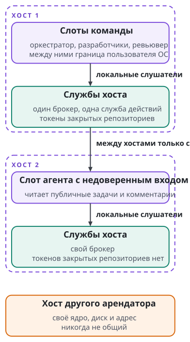

# Размещение: хост арендатора и слоты

Два арендатора не должны встретиться ни в памяти процесса, ни на диске, ни в сети. Между агентами одного арендатора граница может быть слабее, потому что у них один владелец. Глава определяет хост арендатора, показывает, что на нём работает, и сравнивает два способа разместить агентов: несколько слотов на одной машине и одна машина на агента.

## Правило одного арендатора

Разные арендаторы всегда получают разные хосты. На одном хосте работают агенты только одного арендатора. Это требование владельца платформы к сервису, и исключений оно не имеет: ни короткая аренда, ни малая нагрузка, ни нехватка машин не дают права поселить двух арендаторов вместе.

Арендатор для этого правила опознаётся ключом, которым подписано согласие. Несколько слотов оказываются на одном хосте, только если их называет один договор или если новый договор подписан тем же ключом и ссылается на прежний. Заявление "мы из одной компании", совпадение почты или имени основанием не служат: служба размещения сравнивает ключи и хэши договоров.

Хост арендатора это машина с собственным ядром ОС, собственным диском и собственным сетевым адресом. Договор называет класс хоста, и класс определяет, что именно разделено.

| Класс хоста | Что своё | Что общее с другими арендаторами | Чему приходится верить |
| ------ | ------ | ------ | ------ |
| Виртуальная машина | Ядро гостевой системы, диск, сетевой адрес, все службы хоста | Физическая машина и гипервизор поставщика машин | Гипервизору и поставщику машин |
| Выделенная машина | Всё перечисленное и сама физическая машина | Сеть и помещение поставщика | Поставщику машин как владельцу помещения |

Граница между арендаторами проходит по границе машины. Учётная запись ОС как единственная граница для этого не годится: она держится на одном ядре хоста, и ошибка ядра или захваченный root её пробивают (книга Swarma, глава "Пользователь ОС на агента и сеть агента", раздел "Классы изоляции и станция в виртуальной машине"). В виртуальной машине между кодом и ядром физического хоста стоит гипервизор; в выделенной машине общего ядра и общего гипервизора нет вовсе.

Считать ли виртуальную машину на общем гипервизоре "полностью отдельным хостом", решает владелец сервиса. Эта книга предлагает оба класса и делает виртуальную машину классом по умолчанию; вопрос записан в главе "Чего не хватает".

## Что работает на хосте

Хост арендатора это малая установка платформы для одного арендатора. На нём работают службы хоста из главы "Стороны и службы" и слоты.

Арендодатель собирает образ хоста заранее и запечатывает его. Конфигурация каждой службы входит в установочный пакет: файлом владеет администратор машины, группа службы читает его без права записи, и перед стартом служба сверяет хэш конфигурации с манифестом пакета и при расхождении отказывается работать (книга Swarma Link, глава "Договор и согласие", раздел "Где записаны пределы"). В этой конфигурации лежат потолки оператора: наибольший расход на слот, наибольшие пределы, которые арендодатель вообще готов подписать. Арендатор на них не влияет.

Часть политики машины у хоста арендатора выводится из договора. На платформе политику машины задаёт владелец машины, и корневая политика сопоставляет допущенному профилю ровно один сетевой профиль (книга Swarma, глава "Пользователь ОС на агента и сеть агента", раздел "Машина выбирает сеть"). Хост арендатора служит одному договору, поэтому мы предлагаем правило: при подготовке хоста установщик выводит политику из манифеста и потолков оператора. Список адресатов исходящей сети, классы сервисов для шлюза учётных данных и пределы ресурсов слотов берутся из договора и не могут превысить потолки образа. После старта политика принадлежит администратору машины: ни агент, ни арендатор её не меняют, а новый манифест означает новый договор.

Каждый сервис по доверенности сам проверяет доверенность перед привилегированным действием и делает это на ноде, которой доверяет (книга Swarma Link, глава "Сервисы по доверенности", раздел "Определение"; глава "Отзыв и наблюдение цепочки", раздел "Нода проверяющего"). Держать полную ноду Namecoin на каждом хосте дорого: на 10 ноября 2026 года нода занимала около 8,9 ГБ диска, с индексом транзакций около 9,3 ГБ (глава "Личность и имена", раздел "Почему UTXO и почему Namecoin"). Мы предлагаем, чтобы службы хоста читали ноды арендодателя, которые стоят среди общих служб: чтение идёт по закрытому каналу и без права отправки транзакций, а о вершине должны быть согласны не меньше двух независимых нод. Для арендатора это ничего не меняет: службы хоста и ноды принадлежат одному оператору. Недоступная нода закрывает допуск, как и на любой другой установке.

## Слот

Слот это место под одну аренду агента на одно окно. Слот связывает три объекта: окно слота, учётную запись слота и экземпляр агента. Окно слота это окно доверенности этой аренды. Учётная запись слота это отдельный пользователь ОС с собственным домашним каталогом. Экземпляр агента это процесс агента в этой учётной записи (книга Swarma Link, глава "Доступ к агенту: команда и аренда", раздел "Слот").

Менеджер слотов обращается к привилегированной службе машины с пятью командами: создать учётную запись слота, запустить в ней экземпляр, остановить экземпляр, узнать состояние, уничтожить учётную запись. Разрешённые пути, исходящую сеть, пределы процессора и памяти, срок и стирание задаёт политика этой службы (тот же раздел).

Границу слота образуют четыре механизма.

Пользователь ОС отделяет файлы и процессы. Дом слота закрыт для остальных учётных записей; другой слот не читает его файлов, не пишет в его терминал и не шлёт сигналов его процессам (книга Swarma, глава "Пользователь ОС на агента и сеть агента", раздел "Почему пользователь ОС").

Группа ресурсов ограничивает нагрузку. В Linux у каждой учётной записи своя группа cgroup v2 с пределами процессора, памяти, числа процессов и ввода-вывода и свои квоты файловой системы. Для слота на машине проекта платформа задаёт более строгую границу: приватные пространства имён процессов и сети без внешнего интерфейса, пустые capabilities, `no_new_privs`, малый профиль seccomp и запрет исполнения на записываемых путях (та же глава, раздел "Нагрузка: группа ресурсов на поколение"). Мы предлагаем перенести на слот аренды приватные пространства имён, пустые capabilities, `no_new_privs` и профиль seccomp. Сеть без внешнего интерфейса и запрет исполнения слоту аренды не подходят: агент обращается к слушателям служб своего хоста и сам собирает проект арендатора.

Сеть закрыта двумя фильтрами сразу: фильтром адресов менеджера служб на юните слота и пакетным фильтром ядра по учётной записи слота. Каждый страхует отказ другого (книга Swarma Link, глава "Доступ к агенту: команда и аренда", раздел "Слот"). В Swarma Rent слот достигает только локальных слушателей служб своего хоста: шлюза хоста, прокси модели, шлюза учётных данных и сетевого прокси. Прямого выхода наружу у слота нет. Адресатов за пределами хоста достигают службы, и только тех, что названы в договоре: прокси пропускает соединения к адресатам без учётных данных по списку имён и адресов, шлюз учётных данных ходит к хостингу кода и поставщику модели, служба действий ходит к системам, в которые пишет.

Секретов, которые действуют за пределами хоста, в слоте нет. Начальные данные слота содержат идентификатор брони, имя слота, секрет канала, токен доступа к модели, адрес прокси модели и хэш его сертификата; ключа сообщений станции среди них нет. Экземпляр сам открывает соединение к шлюзу и подтверждает себя кодом HMAC-SHA256 от секрета канала (тот же раздел). Токен доступа к модели действует только в окне и на адресе своего слота (та же книга, глава "Сервисы по доверенности", раздел "Прокси модели").

В книге Swarma Link слот завершается по одной из трёх причин: наступил конец окна, печать потрачена, проверка содержания насчитала второе нарушение. При завершении менеджер останавливает экземпляр и уничтожает учётную запись слота, а прокси модели отзывает токен независимо от остановки на машине, поэтому сбой остановки не оставляет доступа к модели (глава "Доступ к агенту: команда и аренда", раздел "Слот"). В Swarma Rent третья причина заменена нарушением, которое по правилам договора прекращает аренду, а учётная запись слота живёт до конца окна выгрузки: экземпляр остановлен сразу, дом уничтожается после окна (глава "Учётные данные арендатора", раздел "Удаление").

Агент в слоте исполняет код: собирает проект арендатора и запускает его тесты. Этот код работает с правами учётной записи слота и получает ровно то, что получает агент: дом слота, локальные слушатели служб и адресатов из списка. Вредный скрипт сборки из чужой зависимости для сервиса равен захваченному агенту, и границы рассчитаны именно на этот случай (глава "Безопасность и отказы"). На платформе сборки, тесты и исполнение кода кандидата вынесены на отдельные раннеры без секретов (книга Swarma, глава "Пользователь ОС на агента и сеть агента", раздел "Службы, слот и проверка кода"); слот аренды от этого правила отступает, и отступление записано в главе "Чего не хватает".

## Станции и пул хостов

У каждого слота своя станция: имя в цепочке и ключ сообщений. Ключ создаётся на хосте, где работает слот, и хоста не покидает. В версии 3 проверяющий доверенности сверяет, что значение имени станции имеет точную форму и указывает на имя арендодателя, названное в доверенности (LIP-0004, раздел 5). Версия 4 называет исполнителя именем и ключом сервиса (LIP-0008, раздел 4). В обеих версиях станции нужно зарегистрированное имя: агент без имени исполнителем в доверенности быть не может.

Регистрировать имя в момент брони долго: между двумя транзакциями регистрации проходит не меньше 12 блоков, а обновление значения ждёт блока (книга Swarma Link, глава "Личность и имена", раздел "Операции с именем"). Мы предлагаем пул. Служба размещения заранее создаёт хосты каждого класса. Новый хост создаёт ключи сообщений для своих слотов и печатает открытые части. Оператор записывает их в значения имён станций обновлением имени; эту операцию подписывает ключ владельца имён станций, и оператор делает её пачкой при пополнении пула. При брони операций с именами нет. Ключ владельца имён станций отдельный: имя арендодателя с ключом доверенностей принадлежит другому ключу, который лежит в холодном хранении и для пула не нужен. Бронь берёт готовый хост с готовыми станциями. После аренды хост уничтожается, а имена его станций получают новые ключи при следующем пополнении.

Одно имя стоит около 0,012 NMC: 0,01 NMC лежит в выходе имени, остальное составляют комиссии. Имя истекает через 36 000 блоков после последнего обновления, около 250 дней, и его продление это обязанность оператора (книга Swarma Link, глава "Личность и имена", разделы "Операции с именем" и "Цена и ёмкость"). Число имён равно числу слотов во всех хостах пула и в работе; от числа прошедших аренд оно не зависит.

Ключ запросов агента тоже создаётся на хосте при брони. Имени ему не нужно: получатель доверенности может быть назван одним ключом.

## Много слотов на одной машине

В первой раскладке все агенты арендатора работают на одном хосте, каждый в своём слоте. Службы хоста одни на всех агентов этого арендатора: один брокер, одна служба действий, один шлюз хоста, один прокси модели.

Между агентами стоит граница пользователя ОС. Она защищает агента от ошибки соседа и от соседа, которого уговорили текстом: продьюсер не читает рабочего каталога ревьювера, даже зная путь (книга Swarma, глава "Пользователь ОС на агента и сеть агента", раздел "Почему пользователь ОС"). От ошибки ядра и от захвата root на хосте она не защищает, и тогда нарушителю достаётся всё, что есть на хосте: дома всех слотов и открытый текст всех учётных данных арендатора у брокера.

Право агента на каждое действие при этом остаётся раздельным. Служба действий на каждом использовании проверяет два полномочия: своё право получить учётные данные у брокера и право вызывающего агента на это действие над этой целью. Агент с доверенностью на один репозиторий не достигает другого, хотя служба держит токены обоих (книга Swarma, глава "Учётные данные и логины"; та же мысль в главе "Модель угроз", раздел "Кому и в чём доверяют").

Агенты одного хоста пишут друг другу через демон a2a этого хоста. Демон проверяет доверенность перед записью входящего сообщения и перед отправкой ответа (книга Swarma Link, глава "Доступ к агенту: команда и аренда", раздел "Доставка между агентами"). Сообщение одного агента другому остаётся данными до допуска проверкой; какие агенты кому вправе ставить задачи, записано в договоре.

## Одна машина на агента

Во второй раскладке у каждого агента свой хост с полным набором служб. Между агентами стоит граница машины, та же, что между арендаторами. Захват одного хоста отдаёт дом одного агента и те учётные данные, которые были заведены именно на этом хосте.

За это платят трижды. Каждый хост несёт постоянный расход на службы и на машину. Агенты общаются по сети через шлюзы хостов, а не через локальный демон. И учётные данные арендатор заводит отдельно для каждого хоста: брокер одного хоста не делится с брокером другого.

## Как выбрать

Таблица сравнивает раскладки.

| Свойство | Много слотов на машине | Машина на агента |
| ------ | --------- | --------- |
| Граница между агентами | Пользователь ОС, группа ресурсов, фильтры сети | Ядро гостевой системы и гипервизор или физическая машина |
| Что отдаёт захват ядра хоста | Дома всех агентов и все учётные данные арендатора на этом хосте | Дом одного агента и учётные данные этого хоста |
| Ресурсы | Делятся пределами групп; тяжёлая сборка одного агента теснит остальных в пределах своих квот | У каждого агента свои |
| Отказ машины | Останавливает всех агентов сразу | Останавливает одного |
| Постоянный расход | Один набор служб и одна машина | Набор служб и машина на каждого агента |
| Связь агентов | Локальный демон a2a | Сеть между хостами |
| Заведение учётных данных | Один раз | На каждый хост отдельно |
| Образ и платформа | Одни для всех агентов | Свои у каждого |

Выбор делается по четырём признакам: какому входу агент верит, какие секреты ему нужны, какие ресурсы и какая платформа ему нужны и чего требуют правила арендатора.

Агенты одной команды с одним набором систем и одним уровнем доверия ко входу размещаются на одной машине. Это раскладка по умолчанию: оркестратор, три продьюсера и ревьювер одного проекта читают один репозиторий и пишут в него же.

Отдельную машину получает агент, для которого верно хотя бы одно из условий.

- Он читает недоверенный вход: задачи и комментарии публичного репозитория, веб-страницы, письма.
- Его службам нужны секреты, которых остальным агентам нельзя касаться ни при каком сбое: токен выпуска, ключ подписи релизов.
- Ему нужны гарантированные ресурсы или другая платформа.
- Правила арендатора требуют границы ядра между ролями, например между тем, кто пишет код, и тем, кто его проверяет.

Первое условие важнее остальных. Текст из недоверенного входа может уговорить агента, и рядом с таким агентом не должно лежать токенов с правом записи во внутренние системы.

Рисунок показывает обе раскладки у одного арендатора и хост другого арендатора рядом.

{.tall}

Одна бронь может сочетать обе раскладки. Договор называет раскладку слотов по хостам, и служба размещения удерживает несколько хостов для одного договора.

## Что делает менеджер слотов в каждой раскладке

Менеджер слотов работает на хосте. Команды создать и уничтожить он принимает от службы размещения, команды запустить и остановить от шлюза хоста. Команды у него в обеих раскладках одни; различается их число и то, что происходит при отказе.

| Событие | Много слотов на машине | Машина на агента |
| ------ | --------- | --------- |
| Подготовка | Создаёт учётные записи всех слотов хоста, каждой свою группу ресурсов и свои фильтры | Создаёт одну учётную запись |
| Запуск | Запускает экземпляр слота при первом сообщении; у слота один экземпляр, и шлюз хоста направляет в него сообщения арендатора и участников, названных в договоре | То же для одного слота |
| Перегрузка | Группа ресурсов держит предел сама; слот, который упёрся в предел памяти, менеджер слотов останавливает, остальные работают | Остановка слота останавливает работу хоста |
| Приостановка аренды | Останавливает все экземпляры, учётные записи оставляет | То же |
| Конец одного слота | Останавливает экземпляр и уничтожает его учётную запись после окна выгрузки; хост живёт до конца последнего слота договора | Уничтожение учётной записи ведёт к уничтожению хоста |
| Конец договора | Останавливает все экземпляры; после окна выгрузки уничтожает все учётные записи, и служба размещения уничтожает хост | То же |

Остановленным слот считается, когда у его учётной записи нет ни одного процесса; выход главного процесса этого не доказывает. В Linux остановка идёт мягким сигналом, затем `cgroup.kill` (книга Swarma, глава "Пользователь ОС на агента и сеть агента", раздел "Нагрузка: группа ресурсов на поколение").

## Отказы размещения

Отказ хоста останавливает слоты этого хоста и не задевает ни других арендаторов, ни общие службы. Доверенности при этом остаются действительными: отказ машины ничего не отзывает. Служба размещения поднимает новый хост из пула, но дома слотов и заведённые учётные данные на него не переезжают: дом восстанавливается из того, что агент успел отправить в системы арендатора, а учётные данные арендатор заводит заново. Ключи станций на новом хосте новые, поэтому арендодатель выдаёт новые доверенности под тем же договором, если договор называет запасные станции, или заключает новый договор со ссылкой на прежний. Порядок разобран в главе "Сценарии", раздел "Хост отказал в середине срока".

Отказ общей службы ведёт себя иначе. Без шлюза обмена и службы бронирования нельзя начать новую аренду, а идущие продолжаются. Без подписанта нельзя выдать и отозвать доверенность; конец окна наступает и без него. Без нод цепочки службы хостов отказывают в привилегированных действиях: недоступная нода закрывает допуск.
