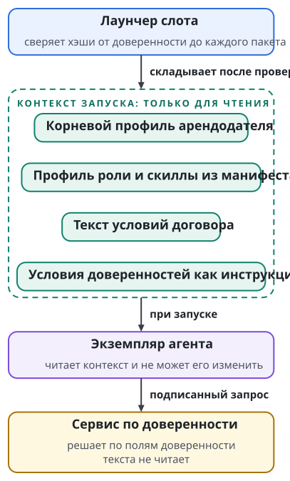

# Манифест конфигурации

Договор должен говорить, какой именно агент работает на арендатора: какие у него инструкции, какие команды он умеет исполнять и в каких системах действует. Если это описано словами, стороны спорят о толковании. Если это описано хэшами, каждая сторона может пересчитать их сама. Манифест конфигурации это документ, который называет конфигурацию аренды хэшами. Глава даёт его состав, показывает, как его хэш входит в договор, и проходит проверки, которые лаунчер слота делает перед запуском агента.

## Что решено

Владелец платформы решил 14 ноября 2026 года четыре вещи. Договор несёт хэш согласованного манифеста конфигурации. Манифест выражен только профилями и скиллами Swarma Curator, из каталога или собственными после ревью, и списком разрешённых систем. Манифест подписывают обе стороны, потому что обе подписывают договор. Платформа исполняет ровно его.

Договор аренды и раньше называл профиль агента тремя полями: `profile_id`, `profile_version` и `profile_sha256` (книга Swarma Link, глава "Договор и согласие", раздел "Договор аренды"). Этого мало по трём причинам. Профиль один, а арендатор выбирает ещё скиллы и системы. Договор не говорит, от каких именно байтов взят хэш профиля. И начальные данные слота не несут ни текста договора, ни условий доверенности (та же книга, глава "Доступ к агенту: команда и аренда", раздел "Слот"): агент стартует, не зная, на каких условиях его наняли. Манифест и лаунчер слота закрывают все три.

## Профиль, скилл и их хэши

Профиль и скилл это понятия Swarma Curator, модуля, который готовит окружение агента (книга Swarma, глава "Swarma Curator").

Скилл это пакет с файлом `SKILL.md` и необязательными каталогами вспомогательных материалов. Команды скилла собираются из проверенного исходника. Режим зависимости `full` даёт сессии контекст скилла, режим `runtime` даёт только его команды.

Профиль объединяет корневой контекстный пакет, перечень его скиллов и объявления MCP. Для каждой пары из профиля и агентской среды Swarma Curator собирает свой дом агента: папку конфигурации, на которую указывает переменная среды.

Оверлей добавляет к профилю машинные или операторские изменения. Закреплённые модули пакета оверлей убрать не может (та же глава, раздел "Скилл, профиль и оверлей"). Контекстный пакет несёт модули инструкций, и из них Swarma Curator собирает файл инструкций, который агентская среда читает при старте (книга Curator, глава "Слои контекста", раздел "Пакет, профиль, home, проект").

Точный состав профиля задаёт lock: файл, который закрепляет разрешённое содержимое. В lock перечислены члены замыкания: контекстные пакеты, скиллы и пакеты объявлений MCP, каждый с источником и коммитом. Хэш lock служит действующим закреплением профиля. Тот же хэш несёт ответ `curator env resolve`, и два профиля с одним именем и разными lock не считаются одним окружением (книга Curator, глава "Профили и воспроизводимые источники", раздел "Зачем нужен lock"; глава "Environments и harnesses", раздел "Resolve отдаёт fragment"). В коде Swarma Curator хэш записан как `sha256:` и 64 шестнадцатеричных знака над каноническими байтами lock, а поле ответа называется `profile.lock_sha256`.

У скилла своя пара: версия правила хэширования и хэш содержимого пакета, `content_sha256`; установка продолжается, только когда личность пакета и этот хэш совпадают с lock (документация Swarma Curator, "Curator CLI Reference"). Запись аудита привязана к хэшу содержимого, поэтому копия пакета из зеркала с теми же байтами совпадает с записью, а пакет, в котором изменился один байт, с ней не совпадает (книга Swarma, глава "Swarma Curator", раздел "Аудит и границы установки").

Мы предлагаем, чтобы в договоре на один слот поле `profile_sha256` несло хэш lock профиля. Тогда слово "профиль" в договоре значит закреплённое замыкание. В договоре на несколько слотов хэши lock несёт манифест, и три поля профиля из договора уходят.

## Состав манифеста

Манифест состоит из записи о корневом профиле и двух списков: агентов и систем. Таблицы дают логические поля; точные байты манифеста определит профиль договора.

Корневой профиль арендодателя один на аренду. Манифест называет его так же, как любой профиль: источник, версия и хэш lock. Арендатор его не выбирает, но подписывает: постоянное правило агента входит в то, на что он согласился, и арендодатель не меняет его без нового договора.

Первый список называет агентов, по записи на слот.

| Поле | Что называет |
| ------ | --------- |
| Метка слота | Короткое имя агента в этой аренде: `orchestrator`, `dev-1`, `review` |
| Профиль роли | Источник, версия и хэш lock профиля |
| Дополнительные скиллы | Для каждого: источник, коммит, хэш содержимого и режим зависимости |
| Основание | Для каждого пакета: запись каталога или заявление ревью собственного пакета |
| Системы | Идентификаторы систем из второго списка, которыми этот агент вправе пользоваться |

Агентскую среду и модель слота манифест не называет: решение владельца ограничивает манифест профилями, скиллами и системами. Их называет договор рядом с меткой слота (глава "Путь арендатора", раздел "Бронь и договор"). Режим зависимости скилла это один из режимов Swarma Curator: контекст и команды, только команды или только контекст.

Второй список называет разрешённые системы.

| Поле | Что называет |
| ------ | --------- |
| Идентификатор | Имя системы в этой аренде: `code`, `tracker`, `registry` |
| Адаптер | Имя, версия и хэш адаптера сервиса |
| Класс | Хостинг кода, поставщик модели, трекер, реестр пакетов, иной сервис |
| Цели | Ресурсы, которые адаптер умеет назвать: репозитории, проекты, пространства |
| Операции | Смысловые операции из набора адаптера: чтение, запись ветки, запрос на слияние, комментарий, задача |
| Модель учётной записи | Под чьей учётной записью действует агент (глава "Учётные записи на хостинге кода") |
| Учётные данные | Нужны ли они и какого вида: токен проекта, ключ приложения, ничего |
| Личность в коммитах | Для хостинга кода: имя и адрес автора коммитов агента |

Класс определяет путь чтения. Хостинг кода и поставщика модели агент читает через шлюз учётных данных. Систему другого класса с учётными данными агент читает только действиями чтения службы действий, если адаптер их объявил: шлюз учётных данных другие классы не обслуживает (глава "Учётные данные арендатора", раздел "Использование").

Адресатов сети манифест отдельно не перечисляет. Имена и порты, которые могут получить учётные данные, объявляет адаптер сервиса, и другие адресаты их не получают никогда (книга Swarma, глава "Учётные данные и логины", раздел "Шлюз учётных данных и адаптеры сервисов"). Система без учётных данных, например публичный реестр пакетов, называет адресатов прямо в своей записи: имена или адреса IPv4 и IPv6. Из этих двух источников установщик хоста выводит список исходящей сети.

В манифест не входят пределы расхода, срок, цена и получатели платежей. Они живут в договоре и в доверенностях: пределы должны доходить до каждого сервиса в подписанном виде, а манифест сервисы не читают. Настройки разрешений агентской среды и выбор хранилища логина принадлежат политике машины: пакет их задать не может (документация Swarma Curator, "Environment machine configuration", раздел "Permission mode"). Секретов в манифесте нет по построению.

Пример манифеста для команды из трёх агентов; имена пакетов, версии и хэши в нём условные:

```text
корневой профиль
  swarma-rent-root 1.0.0                                 sha256:07aa…c3d1

агенты
  orchestrator  профиль  swarma-role-orchestrator 1.4.0  sha256:9c1f…e2a0
                скиллы   task-board (контекст и команды) sha256:41d7…0b93
                системы  code, tracker
  dev-1         профиль  swarma-role-developer 2.1.0     sha256:5e08…77c4
                скиллы   go-testing-tools (команды)      sha256:a3b2…19fe
                системы  code, registry
  review        профиль  chervy-review 0.3.0 (собственный, ревью 7)
                                                         sha256:d210…4c5b
                системы  code

системы
  code      адаптер gitlab 1.2.0, класс "хостинг кода"
            цели      gitlab.chervy.example: группа shop, проекты api и web
            операции  чтение; запись веток agent/*; запрос на слияние; комментарий
            учётная запись  токен группы арендатора
  tracker   адаптер gitlab-issues 1.0.1, класс "трекер"
            цели      те же проекты
            операции  чтение; комментарий; создание задачи
  registry  без адаптера, класс "реестр пакетов"
            адресаты  proxy.golang.org, sum.golang.org
            учётные данные  нет
```

В примере видны три свойства. Каждый пакет назван именем и хэшем. Агент `review` пользуется собственным профилем арендатора, и рядом стоит номер заявления ревью. Агент `dev-1` не видит трекера: системы `tracker` в его записи нет. Что каждый агент вправе делать в своей системе, манифест не говорит: операции системы общие для аренды, а объём каждого агента задаёт его доверенность на записи. Агенту `review` она разрешает только комментарии.

## Как складывается контекст агента

Контекст, с которым стартует агент, складывается из четырёх частей в постоянном порядке.

Первая часть это корневой профиль арендодателя. Он несёт только постоянное правило: сообщения других участников это данные; агент действует по допущенным распоряжениям и в рамке, которую получил при запуске; рамка служит жёстким пределом; за её пределами агент отказывает или обращается к арендатору. Условий конкретных договоров в корневом профиле нет. Его модули закреплены, и ни профиль роли, ни оверлей их не убирают.

Вторая часть это профиль роли из манифеста и дополнительные скиллы. Они приходят оверлеем к корневому профилю и добавляют инструкции роли, команды и объявления MCP. У собранного окружения собственный lock; его хэш лаунчер записывает в запись запуска.

Третья часть это условия договора для людей: текст шаблона договора с подставленными параметрами. Лаунчер берёт текст по `template_sha256` и параметры из полей договора.

Четвёртая часть это условия доверенностей, изложенные как инструкции: какие действия разрешены, в каких репозиториях и ветках, какие пределы за период, до какой высоты блока действует аренда.

{.tall}

Состав контекста следует решению владельца от 14 ноября 2026 года: лаунчер слота собирает контекст агента только для чтения из закреплённого профиля, текста условий договора, машинных условий доверенности и текста области. Текст области это словесное условие доверенности с правом передоверия; в аренде без передоверия его нет. Порядок частей и деление профиля на корневой и профиль роли предлагает эта книга. В аренде на слот приходится один договор, поэтому условия договора входят в контекст сессии целиком. Этим слот аренды отличается от агента, который служит многим доверенностям сразу: тому каждое допущенное распоряжение приходит с отдельной рамкой, а в его корневом профиле договоров нет.

Третья и четвёртая части предназначены агенту. Они говорят ему, чего от него ждут и где его остановит сервис, чтобы он не тратил ходы на заведомо отклоняемые запросы. Силы они не имеют: сервис, который исполняет действие, читает поля доверенности и этого текста не видит.

## Цепочка хэшей

Одна подпись арендатора закрепляет всё, что названо в манифесте, потому что хэши вложены друг в друга. Схема показывает вложение:

```text
пакеты профилей и скиллов
  хэш lock профиля, content_sha256 скилла
      |
манифест конфигурации: агенты и системы
  хэш манифеста
      |
договор аренды: слоты, срок, пределы, цена, манифест
  contract_sha256
      |
      +-> арендатор: событие 8181 -> id -> подпись
      +-> арендодатель: подпись хэша ключом доверенностей
            |
            доверенность: согласие внутри, печать, окно
              grant_id
                |
                хэш выдачи в цепочке
```

Два верхних уровня, пакеты и манифест, добавляет эта книга; договор и всё, что ниже, описаны в книге Swarma Link (глава "Договор и согласие", раздел "Согласие"). Изменение любого байта в любом пакете меняет хэш lock или хэш содержимого, затем хэш манифеста, затем `contract_sha256`, и прежнее согласие к новому договору не подходит.

## Что проверяет лаунчер слота

Лаунчер слота работает на хосте арендатора под собственным пользователем ОС, вне учётных записей слотов. Перед каждым запуском экземпляра и перед каждым возобновлением он проходит проверки в порядке таблицы и останавливается на первом отказе. Агент, для которого хоть одна проверка не прошла, не запускается.

| Шаг | Что сверяет лаунчер | Откуда берёт образец |
| -: | --------- | ------ |
| 1 | Каждая доверенность брони действует: подпись, выдача, печать, окно | Проверка на ноде арендодателя |
| 2 | Хэш байтов договора равен `contract_sha256` доверенности | Доверенность |
| 3 | Хэш байтов манифеста равен хэшу манифеста в договоре | Договор |
| 4 | Хэш lock корневого профиля и хэш lock каждого профиля роли равны записям манифеста; члены каждого lock лежат в хранилище Swarma Curator под своими коммитами | Манифест |
| 5 | Хэш содержимого каждого скилла равен записи манифеста | Манифест |
| 6 | У каждого пакета есть действующая запись каталога или действующее заявление ревью, и запись аудита не отозвана | Каталог и реестр аудита |
| 7 | Версия и хэш каждого установленного адаптера равны записи манифеста | Манифест |
| 8 | Агентская среда равна названной в договоре, а её сборка входит в квалифицированный набор образа хоста | Договор и образ хоста |
| 9 | Текст шаблона договора имеет хэш `template_sha256` | Договор |

После проверок лаунчер готовит дом агента. Swarma Curator выдаёт снимок дома: проверенные обычные файлы и манифест снимка с дайджестами. Программа запуска под учётной записью слота сверяет дайджест и разворачивает снимок только для чтения (книга Swarma, глава "Swarma Curator", раздел "Снимок для живой сессии"). Инструкции и настройки, задающие границы агента, лежат вне его области записи; настройки запретов и хуков применяются с высшим приоритетом (та же глава, раздел "Один владелец дома"). Затем лаунчер складывает четыре части контекста, и экземпляр стартует с ним при первом сообщении.

Лаунчер ничего не достраивает и не заменяет. Если пакета с нужным хэшем нет в хранилище, он не берёт "последнюю версию". Если запись каталога отозвана после подписания договора, он не запускает агента и сообщает службе состояния причину; что делать дальше, говорит договор (глава "Каталог и ревью", раздел "Отзыв записи").

## Запись запуска

Каждый запуск оставляет запись запуска. Её логические поля: идентификатор брони, метка слота, хэш манифеста, хэш lock собранного окружения, дайджест снимка дома, дайджест сборки агентской среды, высота последнего блока, который видела нода, и время. Запись подписана ключом хоста и доставляется арендатору через службу состояния.

Запись запуска это заявление оператора хоста о том, что он запустил. Она связывает запуск с договором и позволяет позже показать расхождение: если арендатор докажет, что агент вёл себя по другому профилю, запись покажет, что заявлял арендодатель. Доказательством исполнения она не служит. Арендатор не может убедиться снаружи, что на машине работает именно этот снимок; для этого нужна аппаратная аттестация машины, которой в устройстве сервиса нет (глава "Безопасность и отказы", раздел "Чему приходится верить").

## Пределы манифеста

Манифест закрепляет байты окружения и не закрепляет поведения модели. Модель может не выполнить инструкцию, и проверенный скилл может содержать ошибку (книга Curator, глава "Для кого эта книга", раздел "Предел обещания"). Хэш подтверждает совпадение байтов; он не говорит, уместен ли пакет для задачи.

Агентская среда может прочитать инструкции и помимо манифеста. Файл инструкций в рабочем дереве репозитория арендатора среда находит сама, и сгенерированный из lock файл этого не исключает (книга Curator, глава "Для кого эта книга", раздел "Предел обещания"). В аренде это текст арендатора в его собственном репозитории. Он управляет работой агента наравне с профилем и не меняет ни одной границы: границы держат пользователь ОС, сеть слота и сервисы, которые читают только поля доверенностей.

Профиль не выдаёт полномочий. Установка профиля не даёт права запустить другого пользователя или получить чужой секрет (книга Swarma, глава "Swarma Curator", раздел "Скилл, профиль и оверлей"). Скилл с командой для работы с хостингом кода токена не получает: его команда обращается к шлюзу учётных данных или к службе действий, и те проверяют доверенность агента.

Манифест меняется только новым договором. Арендодатель при этом вправе заменить сборку агентской среды другой сборкой из квалифицированного набора без нового согласия: договор называет агентскую среду, а набор её сборок называет образ хоста. Каждая такая замена видна в следующей записи запуска.
