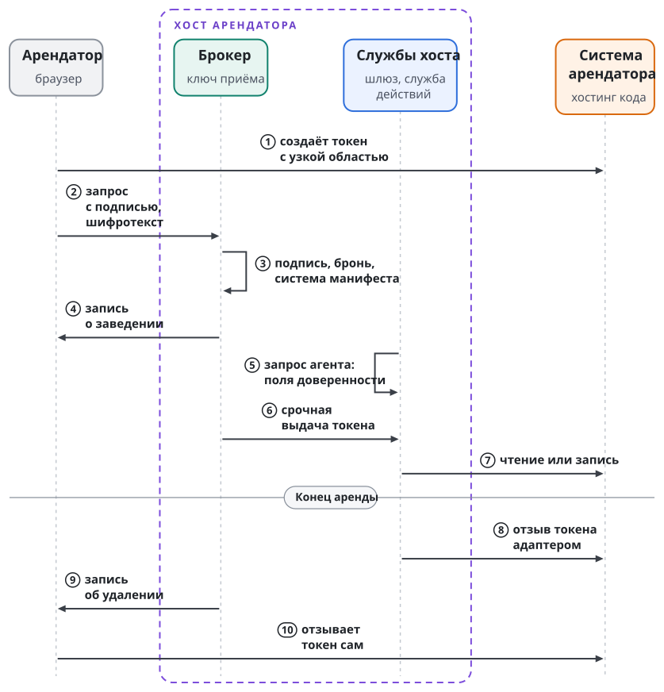

# Учётные данные арендатора

Агент работает в системах арендатора: читает закрытый репозиторий, открывает запросы на слияние, пишет в трекер. Для этого Swarma Rent нужны токены арендатора. Арендатор отдаёт их с четырьмя опасениями: токен прочтёт и вынесет агент, токен увидит арендодатель, токен достанется соседу, токен переживёт аренду. Глава показывает путь токена от арендатора до службы, которая его тратит, и его удаление и говорит, какое из опасений устройство снимает, а какое только ограничивает.

## Основа: агент без секретов

Swarma Rent строится на режиме без секретов у агента. В этом режиме учётная запись агента не получает секретного материала, который действует вне служб платформы. Учётные данные заведены у брокера и выдаются только службам, которые работают под собственными пользователями ОС и тратят их за агента (книга Swarma, глава "Учётные данные и логины", раздел "Режим без секретов у агента").

Открытый текст учётных данных поставщиков и сервисов держат три службы. Брокер держит всё заведённое и не имеет ни сетевого слушателя, ни пересылки запросов. Шлюз учётных данных держит то, что выдано ему для запросов, которые он пересылает: он обслуживает поставщиков моделей и хостинг кода и не пропускает записей во внешние сервисы. Служба действий держит то, что выдано ей для действий, которые меняют общее состояние. Агентская среда держит только заглушку (та же глава, раздел "Кто держит учётные данные").

Каждое использование требует двух отдельно проверенных полномочий. Право службы на материал значит, что служба допущена и держит служебную аренду на эти учётные данные. Право вызывающего на использование значит, что агент, который просит, вправе совершить эту операцию над этой целью. Широкое право службы не восполняет недостающего права агента: служба, которая держит токены двух проектов, не пускает агента с правом на один проект к другому (та же глава, раздел "Два полномочия на каждое использование").

Режим обещает ровно одно: токен не попадает в учётную запись агента. Он не обещает, что агент не злоупотребит доступом в пределах своего права. Агент с правом читать репозиторий через шлюз учётных данных читает его и может передать прочитанное разрешённым путём (книга Swarma, глава "Модель угроз", раздел "Кому и в чём доверяют").

## Что добавляет аренда

Платформа описывает режим для машин одного владельца: учётные данные принадлежат владельцу машины, и он же заводит их у брокера. В аренде владелец учётных данных и владелец машины разные участники. Эта книга предлагает пять дополнений; каждое разобрано в своём разделе.

| Дополнение | Что меняется |
| ------ | --------- |
| Брокер на хост | У каждого хоста арендатора свой экземпляр брокера, шлюза учётных данных и службы действий. Общего брокера на арендаторов нет |
| Привязка к брони | Учётные данные заводятся для одной брони и одной системы манифеста; для системы, которой в манифесте нет, брокер их не принимает |
| Заведение арендатором | Учётные данные заводит арендатор, а не оператор, и общие службы арендодателя видят только шифротекст |
| Блокировку снимает арендатор | После срабатывания растяжки утечки вернуть учётные данные в работу вправе только их владелец |
| Удаление в конце аренды | Конец брони уничтожает учётные данные у брокера, и арендатор получает запись об этом |

Первое дополнение следует из правила одного арендатора. Сервис по доверенности в спецификации привязан к одному пользователю ОС и одному ключу получателя и прямо назван не многопользовательским брокером (LIP-0006, раздел 1). Вместо того чтобы учить брокер различать арендаторов, Swarma Rent даёт каждому арендатору собственный экземпляр на собственной машине. Ошибка в разделении арендаторов внутри одного процесса становится невозможной, потому что такого процесса нет.

## Заведение

Арендатор заводит учётные данные после того, как хост подготовлен, и до того, как агенту понадобится система.

Сначала арендатор получает токен в своей системе. Он проходит собственный вход этой системы и сам выбирает область токена: брокер у поставщика вместо человека не входит (книга Swarma, глава "Учётные данные и логины", раздел "Брокер: одна подписка, аренды на запуски"). Веб-интерфейс показывает, какую область требует адаптер системы, названной в манифесте: какие репозитории, какие права, какой срок. Срок токена арендатор ставит не длиннее срока аренды.

Затем арендатор передаёт токен брокеру своего хоста. У брокера есть ключ приёма: пара ключей, созданная на хосте. Открытую часть арендатор получает вместе с заявлением, которое подписано ключом доверенностей арендодателя и связывает ключ приёма с бронью и хостом. Веб-интерфейс шифрует токен на ключ приёма в браузере арендатора и подписывает запрос на заведение ключом арендатора. Запрос называет бронь, систему манифеста и хэш шифротекста.

Общие службы арендодателя переносят запрос на хост и видят только шифротекст. Заявление о ключе приёма подписано ключом, которого у веб-интерфейса нет: взлом веб-интерфейса не позволяет подставить арендатору чужой ключ приёма так, чтобы подпись сошлась.

У этой защиты есть предел. Код, который проверяет заявление и шифрует токен, отдаёт браузеру тот же веб-интерфейс. Взломанный веб-интерфейс отдаёт код, который копирует токен до шифрования, и подпись заявления от этого не защищает. Арендатор, которому это важно, заводит токен программой, которую получил и проверил отдельно от веб-интерфейса: формат запроса у неё тот же.

Брокер проверяет запрос по пяти условиям: подпись принадлежит ключу арендатора из договора; бронь действует; система названа в манифесте этой брони; шифротекст имеет названный хэш; вид учётных данных тот, которого ждёт адаптер. После расшифровки половина адаптера, которая работает у брокера, проверяет то, что система арендатора позволяет проверить: что токен действует, когда он истекает и, где система это сообщает, какова его область. Токен шире заявленной области брокер принимает, но отмечает в ответе: сузить токен может только арендатор у себя.

Арендатор получает подписанную запись о заведении: бронь, систему, номер версии учётных данных, срок и замечания адаптера. Значения токена в записи нет.

Из сессии агента брокер заведения не принимает (книга Swarma, глава "Учётные данные и логины", раздел "Брокер: одна подписка, аренды на запуски"). Агент не может ни завести учётные данные, ни попросить арендатора ввести токен в чат так, чтобы тот попал к брокеру: путь заведения идёт только через подписанный запрос арендатора.

## Использование

Учётные данные покидают брокер только служебной арендой службе того же хоста. Служба предъявляет брокеру себя, а не агента, и ядро ОС подтверждает, какой процесс подключился (книга Swarma, глава "Учётные данные и логины", разделы "Брокер: одна подписка, аренды на запуски" и "Два полномочия на каждое использование").

Чтение хостинга кода идёт через шлюз учётных данных. Через него идут только поставщики моделей и хостинг кода: другой класс сервисов шлюз обслуживает только после отдельного решения владельца и квалификации (книга Swarma, глава "Учётные данные и логины", раздел "Шлюз учётных данных и адаптеры сервисов"). Трекер или реестр пакетов с учётными данными агент до такого решения читает только действиями чтения службы действий, если адаптер их объявил.

Агент настроен обращаться к шлюзу учётных данных как к адресу хостинга; шлюз завершает соединение агента, проверяет оба полномочия, подставляет учётные данные и открывает собственное соединение к адресату. Адресатов называет только объявление адаптера: имя узла из запроса клиента, иной источник аутентификации или непроверенный адрес их не выбирают. Каждое перенаправление шлюз проверяет как нового адресата до подстановки. Учётные данные, которые прислал сам агент, шлюз отклоняет (книга Swarma, глава "Пользователь ОС на агента и сеть агента", раздел "Шлюз учётных данных").

Любая запись идёт через службу действий. Агент составляет запрос на действие из закрытого набора: отправить ветку, открыть запрос на слияние, оставить комментарий, оставить ревью запроса на слияние, создать задачу. Ключник хоста подписывает запрос ключом запросов агента. Служба действий проверяет доверенность агента на ноде арендодателя, сверяет действие с полями доверенности, записывает операцию в журнал и только потом исполняет через адаптер системы. Текста инструкций она не читает. На каждое действие она возвращает квитанцию, подписанную своим ключом.

Правила внешних эффектов действуют для каждой такой операции. У операции есть устойчивый идентификатор с закреплёнными параметрами и ключ идемпотентности там, где получатель его поддерживает. Служба записывает исход: "выполнена", "отклонена" или "не установлен". При неизвестном исходе слепой повтор запрещён: служба сверяет состояние у получателя или ждёт решения человека. Новый идентификатор сам не разрешает повторить эффект, который мог уже случиться (книга Swarma, глава "Внешние эффекты, остановка и федерация", раздел "Разрешение и исход внешней операции"). Для аренды это значит, что агент не откроет два одинаковых запроса на слияние из-за потерянного ответа, а арендатор увидит в службе состояния операцию с неустановленным исходом и решит её сам.

Приземления в защищённую ветку в наборе действий аренды нет. На платформе публикация и приземление требуют подписанного доской запроса на принятого точного кандидата, и подпись агента вместе с доверенностью этой приёмки не заменяет (книга Swarma, глава "Учётные данные и логины", раздел "Шлюз учётных данных и адаптеры сервисов"). Аренда от этого правила отступает в одном: отправку ветки и запрос на слияние служба действий исполняет по запросу агента и его доверенности, без приёмки доской. Приёмку ведёт арендатор в своей системе: агент открывает запрос на слияние, а сливают его люди арендатора и его защита веток. Арендатор, которому нужно приземление агентом, получает его только как отдельное действие по запросу, подписанному ключом арендатора и называющему репозиторий, ветку и точную ревизию.

Рисунок собирает заведение, использование и удаление в один путь. Слот агента на нём не показан: токена у него нет, а его запрос приходит службам хоста на шаге 5.

{.tall}

## Модель

Доступ к модели устроен так же и имеет два варианта, которые договор называет явно.

В первом варианте модель оплачивает арендодатель. Ключ API поставщика модели лежит у прокси модели на хосте арендатора. У каждого хоста свой ключ с потолком расхода у поставщика, и ключ одного хоста на других не действует. Слот получает случайный токен, привязанный к брони, доверенности, окну не длиннее часа и пределам; он действует только в окне и на адресе своего слота (книга Swarma Link, глава "Сервисы по доверенности", раздел "Прокси модели"). В аренде на срок прокси модели выдаёт токен на период и меняет его в начале следующего. Цена модели входит в цену аренды, а пределы запросов, токенов и стоимости записаны в доверенности.

Во втором варианте арендатор приносит собственный ключ API. Он заводит его у брокера как учётные данные системы класса "поставщик модели", и агентская среда обращается к поставщику только через шлюз учётных данных с адаптером поставщика. Среда получает заглушку, а шлюз учётных данных заменяет её настоящим ключом после проверки обоих полномочий; TLS он не перехватывает (книга Swarma, глава "Учётные данные и логины", раздел "Провайдер модели через шлюз").

В обоих вариантах аренда использует ключи API с оплатой по расходу. Подписка поставщика модели, оформленная на человека, в аренду не сдаётся: режим без секретов начинается с ключей API (тот же раздел), а условия поставщика о передаче подписки третьим лицам арендодатель обязан проверить до запуска сервиса.

## Ротация

Арендатор меняет токен в любой момент аренды тем же путём, каким заводил: получает новый токен в своей системе и подаёт запрос на заведение для той же системы. Брокер записывает новую версию учётных данных. Следующая служебная аренда службе несёт новую версию; действие, которое уже началось со старой, доводится до записи исхода.

Старую версию арендатор отзывает в своей системе сам. До этого момента брокер считает её выданной: растяжка утечки сверяет все выданные версии учётных данных, включая версии без текущей выдачи, до их истечения у поставщика или подтверждённой недействительности (книга Swarma, глава "Учётные данные и логины", раздел "Растяжка утечки"). Адаптер, который умеет спросить сервис о судьбе старого токена, сообщает брокеру, что версия недействительна, и она выходит из набора сверки.

Плановая ротация не требует нового договора: манифест называет систему и вид учётных данных, а не значение.

## Утечка

Растяжка утечки это вторая линия защиты. Там, где шлюз учётных данных завершает соединение агента, он проверяет открытый текст от агента до того, как подставит учётные данные, и узнаёт в нём выданные значения в формах, которые объявил адаптер: сырое значение, base64, hex, процентное кодирование, экранирование JSON. При совпадении шлюз учётных данных блокирует запрос и записывает вердикт без тела и без значения, брокер ставит блокировку аккаунта, шлюз учётных данных и служба действий закрывают текущие использования, сессия останавливается, и владелец получает событие (книга Swarma, глава "Учётные данные и логины", раздел "Растяжка утечки").

На платформе блокировку снимает только владелец, и повторное заведение её не снимает (тот же раздел). В аренде владелец учётных данных это арендатор, и мы предлагаем три уточнения. Событие о совпадении получает арендатор, а арендодатель получает только сам факт блокировки. Снять блокировку вправе только арендатор, подписанным запросом; оператор арендодателя этого сделать не может. Основной путь после блокировки это ротация: арендатор отзывает токен у себя и заводит новый. Запрос на заведение новой версии называет блокировку и снимает её; без такой строки блокировка остаётся. Запрос "снять блокировку и оставить прежний токен" брокер принимает только вместе с явным подтверждением арендатора, что он проверил совпадение и считает его ложным.

Растяжка не видит всего. Внутри непрозрачного туннеля она ничего не видит; разбиение, сжатие, шифрование и медленный вынос её обходят (тот же раздел). Когда основная граница держится, ловить ей в аренде нечего: значений токенов у агента нет. Растяжка срабатывает, когда значение всё же оказалось у агента, например арендатор сам вставил токен в сообщение агенту.

## Удаление

Конец аренды уничтожает учётные данные сразу, а дома слотов после окна выгрузки. Порядок один для всех причин прекращения.

| Шаг | Служба | Что делает |
| -: | ------ | --------- |
| 1 | Шлюз хоста, менеджер слотов | Прекращают доставку сообщений и останавливают экземпляры |
| 2 | Шлюз учётных данных, служба действий | Закрывают очереди и текущие использования с долговечной записью закрытия; действие, которое уже началось, доводится до записи исхода |
| 3 | Брокер | Отзывает служебные аренды |
| 4 | Адаптер системы | Отзывает учётные данные в системе арендатора, если умеет; если не умеет, сообщает об этом в записи |
| 5 | Брокер | Уничтожает хранилище учётных данных брони |
| 6 | Менеджер слотов | Держит дома слотов только для чтения до конца окна выгрузки; арендатор забирает архив |
| 7 | Менеджер слотов, служба размещения | Уничтожают учётные записи слотов и хост |

Арендатор получает запись об удалении. Для каждой системы она говорит, уничтожены ли учётные данные у брокера и отозваны ли они в системе арендатора. Запись подписана ключом хоста и подтверждена службой размещения.

Запись об удалении это заявление арендодателя. Отсутствия копии она не доказывает: администратор машины технически может прочитать память брокера до удаления. Поэтому договор обязывает арендатора к последнему шагу, а веб-интерфейс напоминает о нём для каждой системы: отозвать токен в своей системе. После этого шага уцелевшая копия токена бесполезна.

Уничтожение хоста страхует сбой любого шага. Диск хоста арендатора зашифрован ключом, который существует только на этом хосте; с уничтожением хоста ключ пропадает, и то, что не успел стереть брокер, перестаёт читаться.

## Где существует секрет

Таблица собирает места, в которых токен арендатора бывает открытым текстом.

| Место | Когда | Кто может прочитать |
| ------ | ------ | --------- |
| Система арендатора | Всегда | Арендатор и оператор его системы |
| Браузер арендатора | В момент заведения | Арендатор и код веб-интерфейса арендодателя |
| Брокер хоста | От заведения до удаления | Процесс брокера и администратор хоста |
| Шлюз учётных данных, служба действий | На время служебной аренды | Процесс службы и администратор хоста |

Токена нет в учётных записях слотов, в общих службах арендодателя, в манифесте, в договоре и в квитанциях. Журналы сетевого прокси и шлюза учётных данных пишутся без тел, заголовков, токенов и адресов запросов (книга Swarma, глава "Пользователь ОС на агента и сеть агента", разделы "Что ограничивает CONNECT" и "Шлюз учётных данных"). Журнал службы действий несёт идентификатор операции и исход без учётных данных; это требование этой книги.

Из таблицы видно, что именно обещано. Сосед токена не получит: у соседа другой хост. Агент токена не получит при целой границе пользователя ОС. Аренду токен не переживёт, если арендатор отозвал его у себя. Арендодатель как администратор хоста технически может токен прочитать; это ограничивают договор, журнал доступа оператора и узкая область самого токена (глава "Безопасность и отказы").

Отсюда три совета арендатору, и интерфейс заведения повторяет их при каждом токене. Заводить отдельный токен на каждую аренду. Давать токену самую узкую область, какую допускает система: названные репозитории, права записи только там, где агент пишет. Ограничивать токен сетевым адресом хоста там, где система это умеет: у хоста арендатора свой исходящий адрес, и служба состояния его показывает.
